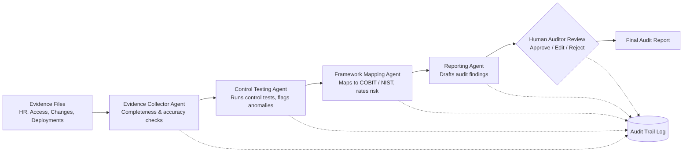

# ITGC Audit Agent

**A multi-agent AI system that automates IT General Controls (ITGC) testing, from evidence collection to audit-ready findings, with a human auditor in control of every conclusion.**


---

## The Problem

ITGC testing is a core part of every SOX and SOC 2 audit, and much of it is still manual. Auditors cross-reference HR rosters against access lists, trace deployments back to change tickets, and write up each exception by hand. The work is repetitive, time-consuming, and prone to sampling gaps.

## The Solution

This project uses a team of specialized AI agents to test **100% of the population** rather than a sample, flag control exceptions, map them to recognized frameworks, and draft findings in standard audit format. A human auditor reviews and approves every finding before it is finalized, and every agent decision is logged for traceability.

**Design principle:** deterministic code performs the record matching, where accuracy must be exact. AI is used only for judgment and writing, where it adds value. This keeps results reliable and explainable.

---

## Architecture



| Agent | Responsibility |
|---|---|
| **Evidence Collector** | Loads evidence, validates completeness and accuracy, summarizes the population |
| **Control Tester** | Executes control tests and flags higher-risk anomalies for attention |
| **Framework Mapper** | Links each exception to its control, framework references, and risk rating |
| **Reporter** | Writes findings in Condition / Criteria / Cause / Effect / Recommendation format |

---

## Controls Tested

| ID | Control | SOX ITGC Domain | COBIT 2019 | NIST CSF 2.0 |
|---|---|---|---|---|
| **AC-01** | Access for terminated users is removed promptly | Access to Programs & Data | DSS05.04 | PR.AA-01 |
| **AC-02** | Multi-factor authentication is enforced on active accounts | Access to Programs & Data | DSS05.04 | PR.AA-03 |
| **CM-01** | All production deployments are linked to an approved change ticket | Program Changes | BAI06.01 | PR.PS-01 |
| **CM-02** | Change requesters cannot approve their own changes (segregation of duties) | Program Changes | BAI06.01 | PR.AA-05 |

---

## AI Governance

Because this system uses AI to support audit conclusions, it is designed with governance controls aligned to the **NIST AI Risk Management Framework**:

| NIST AI RMF Function | How It Is Applied |
|---|---|
| **Govern** | Every agent action and human decision is logged with timestamp, input, output, and approver |
| **Map** | Each agent has a defined, limited scope; AI is excluded from tasks requiring exact matching |
| **Measure** | Detection accuracy and false positives are measured against a known answer key |
| **Manage** | No finding is finalized without human approval; auditors can edit or reject any AI output |

**Independence:** the agents never have access to the answer key, ensuring results are a genuine test of the system's performance.

---

## Test Data

All data is **synthetic** and generated by `src/generate_data.py`. No real personal or company information is used.

| Evidence File | Simulates | Records |
|---|---|---|
| `hr_roster.csv` | HR system export | 500 employees |
| `user_access.csv` | Identity and access management export | 1,012 accounts |
| `change_tickets.csv` | Change management system | 200 tickets |
| `deployments.csv` | Production deployment logs | 210 deployments |

**50 control exceptions** are deliberately planted across the four controls, including 5 high-risk cases of terminated users logging in after their termination date. These are recorded in a separate answer key used to measure detection accuracy. The generator uses a fixed seed, so results are fully reproducible.

---

## Sample Finding

> **Finding AC-01-001: Terminated User Retains Active System Access**
>
> | | |
> |---|---|
> | **Condition** | Account ACC00111 (employee E0058) remained active after the employee's termination on 2025-10-10. The account was used to log in on 2026-09-06, 331 days after termination. |
> | **Criteria** | Access for terminated users must be removed promptly upon termination (COBIT 2019 DSS05.04; NIST CSF 2.0 PR.AA-01). |
> | **Cause** | The termination was not communicated to, or not actioned by, the access administration team. |
> | **Effect** | A former employee retained, and used, access to company systems, creating a risk of unauthorized access to data. |
> | **Recommendation** | Disable the account immediately, review all activity after the termination date, and automate deprovisioning triggered by HR termination events. |
> | **Risk Rating** | High |

*Illustrative example based on the synthetic dataset.*

---

## Results

| Metric | Result |
|---|---|
| Exceptions detected (of 50 planted) | *To be published* |
| False positives | *To be published* |
| Manual review time vs. automated | *To be published* |
| Population coverage | 100% |

*Results will be published on completion of testing.*

---

## Getting Started

**Prerequisites:** Python 3.11+, Git, and an Anthropic API key.

```bash
# Clone the repository
git clone https://github.com/YOUR-USERNAME/itgc-audit-agent.git
cd itgc-audit-agent

# Create and activate a virtual environment
python -m venv venv
source venv/bin/activate        # Windows: venv\Scripts\activate

# Install dependencies
pip install -r requirements.txt

# Add your API key
echo "ANTHROPIC_API_KEY=your-key-here" > .env

# Generate the synthetic audit evidence
python src/generate_data.py
```

> API keys are stored in a local `.env` file excluded from version control and are never committed to the repository.

---

## Project Structure

```
itgc-audit-agent/
├── data/              # Synthetic evidence files
│   └── answer_key/    # Planted exceptions (never accessed by agents)
├── controls/          # Control definitions and framework mappings
├── src/               # Agents, control tests, and data generator
├── app/               # Streamlit auditor review dashboard
├── logs/              # Audit trail of agent and human decisions
├── docs/              # Architecture diagrams and sample reports
└── requirements.txt
```

---

## Roadmap

- [x] Environment setup and secure secrets handling
- [x] Synthetic audit evidence with planted control exceptions
- [ ] Control definitions and framework mappings
- [ ] Deterministic control tests
- [ ] Multi-agent workflow with LangGraph
- [ ] Human-in-the-loop review dashboard and audit trail
- [ ] Accuracy measurement and published results

---

## Tech Stack

**Python** · **LangGraph** · **Claude API** · **pandas** · **Streamlit** · **Faker** · **Git**

**Frameworks:** SOX ITGC · COBIT 2019 · NIST CSF 2.0 · NIST AI RMF

---

## Author

**Rohithraj Baskaran**
Aspiring IT Auditor | IT Governance & AI Risk
[LinkedIn]([https://linkedin.com/in/your-profile](https://www.linkedin.com/in/rohithraj-baskaran-89029820b/)) · [Email](baskaranrohithraj@gmail.com)

---

*This project is for educational and portfolio purposes. All data is synthetic.*
